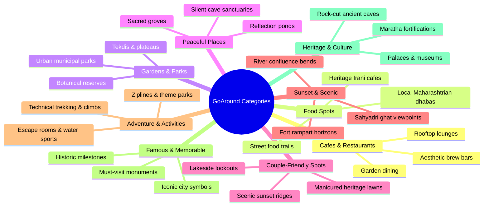

# 🧭 GoAround Destination Intelligence Audit Report

> **Audit Context**: Read-only destination data quality assessment of the 164 published records in GoAround's live Supabase PostgreSQL database (`public.destinations`), imported originally from OpenStreetMap (OSM) via `src/data/goaround_famous_places.geojson`.
>
> **Core Objective**: Evaluate current inventory quality, surface omissions and anomalies, examine audience fit for Pune students and young professionals, and construct a robust categorization system for future milestone deployments.

---

## 1. Verified Inventory Count by Category & Subcategory

The database currently holds **164 published records**. The distribution is heavily skewed toward religious sites and historical forts, while hospitality/food categories are completely absent.

### Category Distribution

| Category | Record Count | Percentage |
| :--- | :---: | :---: |
| **Heritage** (`heritage`) | 107 | 65.2% |
| **Scenic Views** (`scenic_view`) | 39 | 23.8% |
| **Adventure** (`adventure`) | 9 | 5.5% |
| **Nature** (`nature`) | 9 | 5.5% |
| **Cafes & Food** (`food_cafe`) | **0** | **0.0%** |
| **Total** | **164** | **100.0%** |

### Subcategory Breakdown within Categories

```
heritage (107)
├── place_of_worship: 44 (26.8% of entire DB)
├── fort: 32 (19.5% of entire DB)
├── museum: 13 (7.9%)
├── monument: 5 (3.0%)
├── castle: 5 (3.0%)
├── attraction: 3 (1.8%)
├── archaeological_site: 3 (1.8%)
└── viewpoint: 2 (1.2%)

scenic_view (39)
├── attraction: 21 (12.8%)
└── viewpoint: 18 (11.0%)

adventure (9)
├── theme_park: 6 (3.7%)
├── aquarium: 2 (1.2%)
└── zoo: 1 (0.6%)

nature (9)
├── park: 6 (3.7%)
├── theme_park: 2 (1.2%)
└── attraction: 1 (0.6%)
```

> [!NOTE]
> **Key Finding**: 44 places of worship + 32 forts + 5 castles = **81 destinations (49.4% of total inventory)** are either shrines or hill-forts. Conversely, nature parks (6), museums (13), and theme/adventure parks (8) represent a minority, and dining is unrepresented.

---

## 2. Duplicate and Near-Duplicate Clusters

Spatial and name analysis identified several physical sites represented multiple times under distinct records or overlapping coordinates:

### A. Severe Physical Duplicates (< 50 meters apart)

| Cluster / Destination | Record 1 | Record 2 | Distance | Evidence & Problem |
| :--- | :--- | :--- | :---: | :--- |
| **Khandoba Jejuri** | `Khandoba Temple Jejuri` (`dest_way_937734468`) | `Shri Khandoba Martanda Bhairav Mandir` (`dest_node_13661136453`) | **3 meters** | Exact same sanctum on Jejuri hill. A 3rd record, `जेजुरगड` (`dest_way_937734468`), is 72m away. |
| **Parvati Hill Complex** | `Parvati` (`dest_node_2081486315`) | `Parvati Museum` (`dest_node_2850982705`) & `Parvati Temple` (`dest_node_2081486314`) | **4 - 47 meters** | Single hill destination split into 3 distinct database rows. |
| **Aga Khan Palace** | `Aga Khan Palace` (`dest_way_215998826`) | `Mahatma Gandhi Museum` (`dest_node_10795493011`) | **12 meters** | The museum is located inside the palace building. |
| **Malhargad Fort** | `Malhargad` (`dest_way_264627914`) | `Malhargad Fort` (`dest_node_2165009893`) | **19 meters** | Identical hill fort near Saswad entered twice from OSM node vs. way. |
| **Taljai Sports Ground** | `Taljai Cricket Ground` (`dest_way_1009149479`) | `Taljai Ground` (`dest_way_1009149478`) | **19 meters** | Adjoining municipal sports fields on Taljai plateau. |
| **Pataleshwar Cave** | `Pataleshwar` (`dest_way_145620986`) | `Pataleshwar cave temple` (`dest_node_10795493011`) | **27 meters** | Same 8th-century rock-cut temple on JM Road entered twice. |
| **Bhaje Caves Entrance** | `Bhaje Caves` (`dest_way_41393392`) | `प्रवेशद्वार` (`dest_node_2081729952`) | **44 meters** | `प्रवेशद्वार` is simply the entrance gate of Bhaje Caves. |

### B. Single Complex Fragmented Across Multiple Records

* **Rajmachi Fort (5 separate records within 480m)**:
  1. `Rajmachi Fort` (`dest_relation_2861672` or similar)
  2. `Shriwardhan Ballekilla` (Rajmachi's eastern citadel, 417m away)
  3. `Manaranjan Fort` (Rajmachi's western citadel, 205m away)
  4. `Dhanya kothar` (Old fort grain storehouse, 309m away)
  5. `Shri Kaal Bhairavnath Temple` (Village temple at base of citadels, 49m away)
  * *Audit Insight*: If a user plans an outing to Rajmachi, the engine could theoretically pick 3 stops that are all merely different stone structures on the exact same ridge.
* **Sinhagad Fort (4 fragmented records)**:
  1. `Sinhagad Fort` (Main citadel)
  2. `Pune Gate` (Pune Darwaza - 284m away, categorized as a standalone viewpoint)
  3. `Kalyan Gate` (Kalyan Darwaza - 384m away, categorized as a standalone viewpoint)
  4. `Sinhagad Valley` (Valley trail at the base)
* **Purandar & Vajragad**:
  - `Purandar Fort` and `Vajragad Fort` are twin forts sharing the same military ridge.

### C. Repetitive Generic Temple Names

* **9 Bhairavnath Shrines**: 4 records named exactly `Bhairavnath Temple`, plus `Shree Bhairavnath Temple`, `Shri Bhairavnath Temple`, `Kalbhairavnath Temple`, and `Shri Kaal Bhairavnath Temple`.
* **12 Khandoba Shrines**: 6 records named exactly `Khandoba Mandir`, plus variants across Bhor, Vadaj, Talegaon, and FLAME University.

---

## 3. Missing Fields & Data Quality Audit

| Field Name | Present | Missing / Null | % Missing | Impact on GoAround Product |
| :--- | :---: | :---: | :---: | :--- |
| `name` | 164 | 0 | 0.0% | Core title present for all rows. |
| `latitude` / `longitude` | 164 | 0 | 0.0% | Valid floating point coordinates present. |
| `area` | 164 | 0 | 0.0% | Generated honestly via script (`deriveArea()`). |
| `tags` | 164 | 0 | 0.0% | Basic category/subcategory tags present. |
| `metadata` | 164 | 0 | 0.0% | Raw OSM key-values preserved. |
| `description` | 2 | **162** | **98.8%** | Only *Nisargakavi Bahinabai Zoo* & *Tambdi Jogeshwari* have descriptions. |
| `tagline` | 0 | **164** | **100.0%** | Completely null across all records. |
| `cost_per_person` | 0 | **164** | **100.0%** | Completely null; forces "unverified gate fee" mode on all itineraries. |
| `suggested_duration_minutes` | 0 | **164** | **100.0%** | Completely null; planner defaults to hardcoded 75 mins per stop. |
| `image_url` | 0 | **164** | **100.0%** | Completely null; UI relies entirely on SVG category icon fallbacks. |
| `crowd_level` | 0 | **164** | **100.0%** | Completely null; crowd insights disabled. |
| `best_time_of_day` | 0 | **164** | **100.0%** | Completely null; planner engine cannot sequence stops by morning/sunset. |
| `local_tip` | 0 | **164** | **100.0%** | Completely null; UI falls back to generic UPI cash warning. |

> [!WARNING]
> **Data Reality Check**: The database is structurally solid, but **content-poor**. All rich metadata (timings, ticket prices, verified durations, local tips, and photos) currently exists only in the 8 hardcoded mock records in `puneDestinations.ts`. The 164 live Supabase records contain only coordinates, names, categories, and raw OSM properties.

---

## 4. Coordinate Validity & Distance Extremes

All 164 records have mathematically valid coordinates within Maharashtra bounds.

* **Latitude Range**: `18.0457759° N` to `19.3212339° N`
* **Longitude Range**: `73.3350035° E` to `74.3756022° E`
* **Geographic Center**: Central Pune (Shaniwar Wada: `18.5196° N, 73.8553° E`)

### Radius Analysis from Central Pune

```
Within 15 km (Urban & Immediate Hills):  54 places (32.9%)
15 km to 45 km (Greater Pune Outskirts):  48 places (29.3%)
45 km to 70 km (Lonavala / Bhor / Saswad): 28 places (17.1%)
70 km to 90 km (Deep Western Ghats / Junnar): 34 places (20.7%)
```

### Suspicious or Impractical Destinations for Day Outings

The following destinations are located **80–90 km away from Pune** in northern Junnar/Ghatghar near the Harishchandragad boundary. While legitimate geographic features, they require 3.5 to 4.5 hours of one-way travel on winding ghat roads, making them **unsuitable for standard 4-hour or 8-hour day trips**:

1. `Bhairavgad Fort` (90.0 km) — Severe rock-climbing wall, 4+ hours driving.
2. `Dev Daubdya Viewpoint` (89.7 km)
3. `Sindola Fort` (89.3 km)
4. `Nimgiri Fort` & `Hanumantgad Fort` (86.7 km)
5. `Jivdhan Fort` & `Vaanarlingi Pinnacle` (86.1 km) — High-difficulty technical trek.
6. `Hadsar Fort` (83.7 km)
7. `Dhakoba Fort` (82.3 km)
8. `Chawand Fort` (80.6 km)

---

## 5. Irrelevant or Low-Utility Candidates for Target Audience

GoAround targets **Pune college students, young working professionals, and weekend outing groups**. The audit surfaced several records that do not constitute standalone leisure destinations:

### Candidates to Deprecate or Merge

| Place Name | DB Category | Reason for Low Utility | Recommended Action |
| :--- | :--- | :--- | :--- |
| **`प्रवेशद्वार`** | `heritage / archaeological_site` | Literally means "Entrance Door" in Marathi; it is the entry gate for Bhaje Caves. | Merge into `Bhaje Caves` or unpublish. |
| **`Jay chand chowk`** | `heritage / monument` | A municipal road intersection / chowk; not an outing destination. | Unpublish. |
| **`Kalyan Gate`** | `scenic_view / viewpoint` | Gate on Sinhagad Fort. Users visit Sinhagad, not the gate alone. | Merge metadata into `Sinhagad Fort`. |
| **`Pune Gate`** | `scenic_view / viewpoint` | Gate on Sinhagad Fort. | Merge metadata into `Sinhagad Fort`. |
| **`Dhanya kothar`** | `scenic_view / attraction` | Ancient granary ruin on Rajmachi Fort. | Merge into `Rajmachi Fort`. |
| **`Killedar Godaji Bhuruk Samadhi`** | `heritage / monument` | Isolated grave memorial stone on a remote ridge. | Demote to trail waypoint. |
| **`Network Point (Jio)`** | `scenic_view / viewpoint` | A rocky outcrop where hikers catch 4G signal; not a scenic attraction. | Unpublish. |
| **`Taljai Cricket Ground`** | `nature / park` | Local youth cricket pitch, duplicate of Taljai Ground. | Merge into `Taljai Watch Tower / Tekdi`. |
| **`Wildernest Country Homes`** | `scenic_view / attraction` | Gated private second-home / bungalow plotting scheme. | Unpublish (commercial real estate). |
| **`Artha Mandap Dakhsin Dwar Morgaon`** | `heritage / place_of_worship` | Side gate of Morgaon Mayureshwar temple. | Merge into `Shri Mayureshwar Mandir Morgaon`. |
| **`Dharma Mandap Purva Dwar Morgaon`** | `heritage / place_of_worship` | Eastern gate of Morgaon temple. | Merge into `Shri Mayureshwar Mandir Morgaon`. |

### Non-Latin Script Placeholders (Need English Normalization)

* `जेजुरगड` (`heritage/fort`) &rarr; Should be English: **Jejuri Gad (Khandoba Fort)**
* `प्रवेशद्वार` (`heritage/archaeological_site`) &rarr; Entrance gate
* `लेण्याद्री च्या लेण्या` (`scenic_view/attraction`) &rarr; Should be English: **Lenyadri Buddhist Caves**
* `संत दर्शन` (`scenic_view/attraction`) &rarr; Should be English: **Sant Darshan Museum (Lonavala)**

---

## 6. Destinations Fitting Multiple Categories

Many premier destinations fit multiple themes and should support secondary search tags:

```mermaid
graph TD
    Sinhagad["Sinhagad Fort"] --> Heritage["Heritage (Historic Citadel)"]
    Sinhagad --> Scenic["Scenic View (Valley Panoramas)"]
    Sinhagad --> Adventure["Adventure (Steep Donje Trek)"]

    AgaKhan["Aga Khan Palace"] --> Heritage2["Heritage (National Freedom Memorial)"]
    AgaKhan --> Couple["Couple-Friendly (Manicured Italian Gardens)"]
    AgaKhan --> Museum["Museum (Gandhi Archives)"]

    Parvati["Parvati Hill"] --> Heritage3["Heritage (Peshwa Temples)"]
    Parvati --> Sunset["Sunset & Scenic (360° City View)"]
    Parvati --> Peaceful["Peaceful (Early Morning Walks)"]

    Bhaje["Bhaje Caves"] --> Heritage4["Heritage (2nd Century BC Rock Caves)"]
    Bhaje --> Adventure2["Adventure (Monsoon Waterfall Hike)"]
```



Other prominent multi-category destinations:
* **Ramdara Temple**: `Heritage` + `Peaceful Places` (placid lake reflections) + `Couple-Friendly`.
* **Tikona Fort**: `Heritage` + `Sunset & Scenic` + `Adventure` (Pawna Lake backdrop).
* **Baneshwar**: `Nature` + `Heritage` (Peshwa shrine) + `Peaceful Places` (dense sacred grove).
* **Tiger Point / Lion Point**: `Sunset & Scenic` + `Couple-Friendly` + `Adventure`.
* **Sarasbaug**: `Gardens & Parks` + `Heritage` + `Food Spots` (adjacent chowpatty).

---

## 7. Audience Suitability Matrix

Based on access difficulty, commercial amenities, crowd nature, and travel time:

### A. Friends & Groups (High Energy, Treks, Lakes, Social Hangouts)
1. `Sinhagad Fort` (Trekking, rustic pitla-bhakri, group views)
2. `Lohagad Fort` (Famous group monsoon trek)
3. `Visapur Fort` (Steep waterfall staircase climb)
4. `Rajmachi Fort` (Night camping, off-road biking, fireflies)
5. `Tikona Fort` (Panoramic views over Pawna lake)
6. `Della Adventure` (High-octane group sports, zipline, ATV)
7. `Diamond Parks` (Water park & camping)
8. `Mystery Rooms, KP` (Team escape challenges)
9. `Tiger Point & Lion Point` (Lonavala group road trips, chai & bhutta)
10. `Bhushi Dam` (Water cascades, youth weekend hangout)

### B. Couples (Aesthetic, Romantic, Scenic, Low Noise)
1. `Aga Khan Palace` (Italianate arches, peaceful shaded lawns)
2. `Kamala Nehru Park` (Quiet lawns, central location)
3. `Taljai Watch Tower` (Quiet evening breeze, hill trail)
4. `Bhopdeo Ghat Viewpoint` (Spectacular romantic sunset over Saswad valley)
5. `Necklace Point` (Curved river confluence, scenic photo opportunities)
6. `Kundalika Valley Viewpoint` (Deep misty gorge overlook)
7. `Bund Garden` (Riverside evening walkways)
8. `Peacock Bay` (Scenic water inlet view)
9. `Ramdara Temple` (Calm reflection pond, shaded wooden benches)
10. `Sarasbaug` (Lotus pond, green landscape)

### C. Families (Paved Access, Toilets, Cultural Dignity, Multi-Generational)
1. `Shaniwar Wada` (Flat stone pathways, historical gardens)
2. `Raja Dinkar Kelkar Museum` (Rich indoor cultural collections)
3. `Joshi's Museum of Miniature Railways` (Loved by children and seniors alike)
4. `Shreemant Dagdusheth Halwai Ganpati` (Accessible, high religious significance)
5. `Kasba Ganpati` (Historic city heart)
6. `Appughar` (Classic children's amusement rides)
7. `Nisargakavi Bahinabai Chaudhary Zoo` (Snake park and aviary)
8. `Choki Dani` (Rajasthani cultural dance, dining, puppet shows)
9. `Shivsrushti Theme Park` (Interactive 3D Maratha history exhibits)
10. `ISKCON NVCC Temple` (Spacious, impeccably clean, elevator access, pure veg dining)

### D. Students (Budget-Friendly, Two-Wheeler Accessible, Quick Thrills)
1. `Sinhagad Fort` (Direct two-wheeler ride up, ₹50-100 food cost)
2. `Pataleshwar Cave Temple` (Free entry, JM Road location, cool stone sanctuary)
3. `Sambhaji Park` (Zero/nominal entry fee, central hangout)
4. `Parvati Hill` (Free stair climb, high calorie burn, sunset view)
5. `Taljai Tekdi` (Zero entry ticket, two-wheeler parking available)
6. `Lal Mahal` (₹5-10 municipal fee, rich history)
7. `Bhopdeo Ghat` (Free scenic motorcycle ride)
8. `Malhargad Fort` (Low-traffic student road-trip via Dive Ghat)
9. `Baneshwar` (Nasrapur budget bike trip with waterfall)
10. `Raja Dinkar Kelkar Museum` (Student concession tickets)

### E. Solo Outings (Introspective, Photography, Quiet Walks, Historical Immersion)
1. `Pataleshwar Cave Temple` (Cool monolithic silence in urban core)
2. `Taljai Hill Forest Trail` (Peacock spotting, morning trail runs)
3. `Bharat Itihas Sanshodhak Mandal` (Rare archival manuscripts and coins)
4. `Shinde Chhatri` (Intricate Anglo-Rajasthani architecture photography)
5. `Bhor Rajwada` (Echoing wooden palace courtyards, historical reflection)
6. `Ramdara Temple` (Peaceful lake walk away from city noise)
7. `Kundalika Valley` (Solo mindfulness and sweeping horizon views)
8. `Raireshwar Plateau` (Vast open wind-swept tableland)
9. `Nighoj Potholes` (Unique geological river formations)
10. `Parvati Hill` (Dawn photography before city wakes up)

---

## 8. Potentially Valuable Places Miscategorized in Live Database

| Destination Name | Current DB Category | True Identity | Recommended Fix |
| :--- | :--- | :--- | :--- |
| **`Aga Khan Palace`** | `scenic_view / attraction` | 19th-century royal palace & national Gandhi memorial. | Reclassify to **`heritage / monument`**. |
| **`Lal Mahal`** | `scenic_view / attraction` | 1630 historic reconstructed palace in city center. | Reclassify to **`heritage / palace`**. |
| **`Shinde Chhatri`** | `scenic_view / attraction` | 18th-century royal cenotaph & architectural monument. | Reclassify to **`heritage / monument`**. |
| **`Sarasbaug`** | `scenic_view / attraction` | Historic landscaped public garden & Ganesha shrine. | Reclassify to **`nature / park`** + **`heritage`**. |
| **`HAL Marut`** | `scenic_view / attraction` | Decommissioned fighter jet display inside Kamala Nehru Park. | Merge into `Kamala Nehru Park`. |
| **`Neemgiri Hanumantgad Viewpoint`** | `heritage / viewpoint` | Scenic cliff overlook between Junnar forts. | Reclassify to **`scenic_view / viewpoint`**. |
| **`Bhaje Caves`** | `heritage / attraction` | 2nd-century BC Buddhist rock-cut monastery. | Reclassify to **`heritage / archaeological_site`**. |
| **`Bhushi Dam`** | `nature / attraction` | Overflowing water reservoir masonry spillway. | Tag with **`water_body / scenic`**. |
| **`Choki Dani`** | `adventure / theme_park` | Rajasthani ethnic dining village and cultural resort. | Tag with **`food_culture / family`**. |
| **`Shivsrushti Historical Theme Park`** | `heritage / museum` | Modern experiential cultural theme park. | Tag with **`adventure / cultural_park`**. |

---

## 9. Proposed 9-Tier Categorization System

To transform GoAround from an uncurated OSM dump into a refined planning product, adopt this 9-category taxonomy:



---

## 10. Prioritized Top 25 Candidates per Category (Verified Evidence)

> [!IMPORTANT]
> **Audit Integrity Notice**: For **Cafes & Restaurants** and **Food Spots**, the database currently has **ZERO** records. Rather than fabricating entries, this audit honestly reports them as empty and outlines the exact dataset needed to fulfill them.

### Category 1: Cafes & Restaurants (0 in DB)
* **Current Database Count**: **0**
* **Finding**: `destinations` table contains no food or beverage establishments.
* **Required Expansion**: Ingest curated entries (e.g., KP artisanal cafes, Deccan student cafes, Baner rooftop bistros, Mulshi lakefront eateries).

### Category 2: Food Spots (0 in DB)
* **Current Database Count**: **0**
* **Finding**: Zero street food clusters or local Maharashtrian dhabas in live database.
* **Required Expansion**: Ingest verified hubs (FC Road food street, Tulshibaug, Camp burger/bakeries, Sinhagad ghat pitla-bhakri stalls).

---

### Category 3: Gardens & Parks (Top 10 Available in DB)
*All valid park/garden records currently in the database:*
1. **`Kamala Nehru Park`** (`nature/park`) — Prabhat Road; well-maintained urban garden.
2. **`Sambhaji Park`** (`nature/park`) — JM Road; lush trees, aquarium, walking tracks.
3. **`Bund Garden`** (`nature/park`) — Sangamwadi; heritage riverside park.
4. **`Sarasbaug`** (`scenic_view/attraction` &rarr; Reclassify to Park) — 25-acre garden with lotus pond.
5. **`Pimple Gurav Dinosaur Park`** (`nature/theme_park`) — PCMC garden with life-sized models.
6. **`Nisargakavi Bahinabai Chaudhary Zoo`** (`nature/park`) — Akurdi botanical garden & aviary.
7. **`Aga Khan Palace Grounds`** (`scenic_view`) — Vast landscaped lawns.
8. **`Baneshwar Sacred Forest`** (`heritage/place_of_worship`) — Forest sanctuary & garden near Nasrapur.
9. **`Taljai Tekdi Forest`** (`nature/park`) — Natural green reserve in South Pune.
10. **`Diamond Parks Green Campus`** (`nature/theme_park`) — Suburban park landscape.

---

### Category 4: Peaceful Places (Top 15 Verified Candidates)
1. **`Ramdara Temple & Lake`** — Still waters, reflection pond, quiet valley setting.
2. **`Pataleshwar Cave Temple`** — Subterranean basalt cool, sheltered from JM Road traffic.
3. **`Baneshwar Temple & Forest`** — Dense sacred grove with natural birdsong.
4. **`Taljai Watch Tower Trail`** — Early morning peaceful peacock sightings.
5. **`Kundalika Valley Viewpoint`** — Uncrowded, vast misty valley silence.
6. **`Necklace Point`** — Peaceful river confluence overview in Bhor.
7. **`Nighoj Kund`** — Quiet geological rock canyons.
8. **`Raireshwar Fort Plateau`** — Isolated, vast tableland meadow.
9. **`Nira Deoghar Dam Viewpoint`** — Placid waters, gentle mountain breeze.
10. **`Parvati Temple (Dawn)`** — Peaceful sunrise city view before tourist hours.
11. **`Bhor Rajwada Courtyard`** — Historic wooden architectural quietude.
12. **`ISKCON NVCC Temple`** — Spiritual tranquility, clean spacious courtyards.
13. **`Bhaje Caves (Early Morning)`** — Ancient monastic meditation spaces.
14. **`Omkareshwar Mandir Riverbank`** — 18th-century riverside stone courtyard.
15. **`Dr. Babasaheb Ambedkar Museum`** — Quiet, dignified memorial grounds on SB Road.

---

### Category 5: Couple-Friendly Spots (Top 15 Verified Candidates)
1. **`Aga Khan Palace`** — Italianate architecture, sprawling lawns, elegant couple strolls.
2. **`Kamala Nehru Park`** — Classic, clean central garden for long conversations.
3. **`Taljai Watch Tower & Hill`** — Scenic sunset paths, breezy hilltop.
4. **`Bhopdeo Ghat Viewpoint`** — Panoramic sunset view over Saswad plains.
5. **`Necklace Point`** — Picturesque horseshoe river bend (popular photo spot).
6. **`Bund Garden`** — Shaded riverside promenades.
7. **`Sarasbaug`** — Evening strolls around the lotus pond.
8. **`Tiger Point (Lonavala)`** — Classic couple getaway overlooking clouds.
9. **`Lion Point (Lonavala)`** — Breezy cliff edge with tea and bhutta.
10. **`Peacock Bay (Khadakwasla)`** — Serene water inlet vistas.
11. **`Kundalika Valley Viewpoint`** — Breathtaking dramatic cliff backdrops.
12. **`Della Adventure`** — Exciting date day out with shared activities.
13. **`Mystery Rooms, KP`** — Engaging couple team-puzzle date.
14. **`Sunset Point (Lonavala)`** — Golden hour views over the Western Ghats.
15. **`Ramdara Lake Shoreline`** — Romantic wooden bridges and water lilies.

---

### Category 6: Sunset & Scenic Places (Top 25 Verified Candidates)
1. **`Tiger Point`** — Lonavala’s premier cliff drop.
2. **`Lion Point`** — Sweeping views across deep gorges.
3. **`Bhopdeo Ghat Viewpoint`** — High ridge overlook toward Saswad.
4. **`Necklace Point`** — Meandering river bend near Bhor.
5. **`Taljai Watch Tower`** — Panoramic 180° sunset over Pune skyline.
6. **`Parvati Hilltop`** — 360° view of city horizon at dusk.
7. **`Kundalika Valley Viewpoint`** — 1,000-ft vertical drop overlooking Tamhini forests.
8. **`Sunset Point (Maval)`** — Prime western horizon overlook.
9. **`Kalyan Gate (Sinhagad)`** — Cliff edge looking toward Panshet & Torna.
10. **`Sinhagad Fort Ramparts`** — Cool valley winds and evening golden glow.
11. **`Tikona Fort Summit`** — Pyramid peak looking directly down upon Pawna Lake.
12. **`Lohagad Vinchukata`** — Dramatic scorpion-tail cliff extending into the clouds.
13. **`Visapur Fort Plateau`** — Wide rocky tableland with monsoon waterfall drops.
14. **`Nira Deoghar Dam`** — Sparkling reservoir reflection at sunset.
15. **`Peacock Bay`** — Quiet waters glowing under the golden hour.
16. **`Monkey Point`** — Deep ravine views adjoining Lion Point.
17. **`Vaanarlingi Pinnacle`** — Towering 400-ft rock spire in Junnar.
18. **`Bhairavgad Fort Ridge`** — Razor-sharp rock crest in Sahyadris.
19. **`Mutha River Viewpoint`** — Natural river curve overlook.
20. **`Dev Daubdya Viewpoint`** — Pristine northern Sahyadri horizons.
21. **`Dhak Bahiri Viewpoint`** — Dramatic canyon views.
22. **`Ghat Viewpoint (Junnar)`** — Mountain pass panoramic look.
23. **`Zunzar Machi`** — Lower cliff bastion view.
24. **`Malhargad Bastion`** — Sunset looking back toward Pune city basin.
25. **`Purandar Fort Ballekilla`** — High-altitude panoramic view over Saswad.

---

### Category 7: Adventure & Activities (Top 20 Verified Candidates)
1. **`Della Adventure`** — Commercial extreme sports (bungee, zorbing, zipline).
2. **`Mystery Rooms, KP`** — Live room-escape challenges.
3. **`Diamond Parks`** — Water slides, obstacle courses, suburban camping.
4. **`Rajmachi Fort Trek`** — Legendary 16 km forest trail from Lonavala.
5. **`Tail Baila`** — Vertical rock wall dyke (rock climbing & rappelling).
6. **`Sinhagad Fort Trek`** — Classic 45-minute steep climb from Donje base.
7. **`Dhak Bahiri Cave`** — High-adrenaline cliff climb via wooden pegs.
8. **`Bhairavgad Fort`** — Near-vertical 80° rock-cut steps.
9. **`Tikona Fort Climb`** — Steep rock steps and rampart scrambles.
10. **`Visapur Fort Monsoon Trek`** — Walking up flowing waterfall steps.
11. **`Lohagad Fort Hike`** — Scenic, accessible stair climb.
12. **`Jivdhan Fort`** — Difficult rock climbing through ancient gateway.
13. **`Rohida Fort Trek`** — High-wind ridge trek near Bhor.
14. **`Purandar Fort Trek`** — Military historic climb.
15. **`Bhushi Dam Waterfall Cascades`** — Scrambling on wet masonry steps.
16. **`Japalouppe Equestrian Centre`** — Horse riding and riding trails.
17. **`Valley of Adventure`** — Lonavala outdoor activities.
18. **`Appughar`** — Classic roller coaster rides.
19. **`Korigad Fort Trek`** — Easy forest walk up to expansive lake fort.
20. **`Hadsar Fort`** — Tunnel and rock-cut stairs in Junnar.

---

### Category 8: Famous & Memorable Places (Top 25 Verified Candidates)
1. **`Shaniwar Wada`** — Definitive heart of the Maratha Peshwa capital.
2. **`Aga Khan Palace`** — Gandhi memorial & national freedom landmark.
3. **`Shreemant Dagdusheth Halwai Ganpati`** — Maharashtra’s most revered Ganesh temple.
4. **`Sinhagad Fort`** — Iconic symbol of Maratha valor (Tanaji Malusare).
5. **`Lohagad Fort`** — Pune’s most visited weekend monsoon fortress.
6. **`Pataleshwar Cave Temple`** — 8th-century monolithic rock-cut wonder.
7. **`Raja Dinkar Kelkar Museum`** — World-famous 20,000-artifact collection.
8. **`Parvati Hill & Temple`** — 103 stone steps, commanding city landmark.
9. **`Lal Mahal`** — Chhatrapati Shivaji Maharaj's historic childhood home.
10. **`Khandoba Temple, Jejuri`** — Turmeric-covered golden temple hill.
11. **`Bhimashankar Temple`** — Ancient Jyotirlinga shrine in dense sanctuary.
12. **`Sarasbaug`** — Beloved 200-year-old temple garden.
13. **`Shivneri Fort`** — Birthplace of Chhatrapati Shivaji Maharaj.
14. **`Rajmachi Fort`** — Western Ghats' most storied trekking fort.
15. **`Bhaje Caves`** — Ancient 2nd-century BC Buddhist rock architecture.
16. **`Joshi's Museum of Miniature Railways`** — Unique working miniature railway.
17. **`Tiger Point`** — Pune region's most famous cliffside overlook.
18. **`Bhuleshwar Temple`** — Exquisite 13th-century Yadava stone carvings.
19. **`Kasba Ganpati`** — Historical Gramdaivat of Pune established 1630.
20. **`Choki Dani`** — Famous cultural evening destination.
21. **`Bund Garden`** — Landmark Fitzgerald bridge and river gardens.
22. **`Purandar Fort`** — Birthplace of Sambhaji Maharaj.
23. **`Shinde Chhatri`** — Wanowrie architectural jewel.
24. **`Tikona Fort`** — Famous triangular fort overlooking Pawna.
25. **`Visapur Fort`** — Twin fortress to Lohagad.

---

### Category 9: Heritage & Cultural Places (Top 25 Verified Candidates)
1. **`Shaniwar Wada`** (Built 1732; monumental spiked teak Dilli Darwaza)
2. **`Lal Mahal`** (Historic Maratha center in Kasba Peth)
3. **`Aga Khan Palace`** (Built 1892; Italian arches, Kasturba Gandhi Samadhi)
4. **`Shinde Chhatri`** (18th-century memorial with ornate Anglo-Rajasthani carvings)
5. **`Raja Dinkar Kelkar Museum`** (Historic Mastani Mahal reconstruction)
6. **`Pataleshwar Cave Temple`** (Rashtrakuta dynasty rock-cut temple with Nandi mandapa)
7. **`Bhor Rajwada`** (19th-century royal palace of the Pant Sachiv dynasty)
8. **`Bhaje Caves`** (Hinayana Buddhist chaitya hall with wooden roof ribs)
9. **`Lenyadri Caves`** (Rock-cut Buddhist monastery housing Girijatmak Ganesh)
10. **`Shivneri Fort`** (Birthplace of Shivaji Maharaj; Badami talav & Shivai temple)
11. **`Sinhagad Fort`** (Tanaji Samadhi, Rajaram Maharaj Samadhi, Devtaki springs)
12. **`Purandar Fort`** (Site of the 1665 Treaty of Purandar)
13. **`Bhimashankar Temple`** (Nagara style stone architecture dating to 13th century)
14. **`Bhuleshwar Temple`** (Spectacular Yadava dynasty Hemadpanthi stone carvings)
15. **`Kasba Ganpati`** (Historical temple blessed by Jijabai in 1630)
16. **`Tambdi Jogeshwari`** (Peshwa patron deity temple in Budhwar Peth)
17. **`Omkareshwar Mandir`** (Peshwa-era stone temple on Mutha riverbank)
18. **`Bharat Itihas Sanshodhak Mandal`** (Historical institute with 1.5 million rare documents)
19. **`Shivsrushti Theme Park`** (Historical representation of the Maratha Empire)
20. **`Dr. Babasaheb Ambedkar Museum`** (Artifacts and books of the Constitution architect)
21. **`Mahatma Phule Vastu Sangrahalaya`** (1888 colonial museum of arts and crafts)
22. **`Morya Gosavi Temple`** (14th-century Ganesh Bhakti movement shrine)
23. **`Induri Fort`** (18th-century river fortress built by Sarsenapati Khanderao Dabhade)
24. **`Sangramdurga Fort (Chakan)`** (Historic land fort defended by Firangoji Narsala)
25. **`Raireshwar Fort Temple`** (Where Shivaji Maharaj took the oath of Swarajya in 1645)

---

## 11. Key Audit Findings & Strategic Roadmap

```
Current Status:
[164 Raw OSM Spots] ──► [Forts & Shrines Heavy] ──► [Zero Descriptions, Zero Photos, Zero Costs]

Required Next Milestones:
1. Data Enrichment: Enrich top 40 core Pune attractions with photos, verified durations, and gate tickets.
2. Deduplication & Cleanup: Merge 7 duplicate clusters (Jejuri, Parvati, Malhargad, Bhaje, Rajmachi, Sinhagad).
3. Inventory Balance: Ingest curated food/cafe dataset (FC Road, KP, Camp, Deccan) to unblock dining itineraries.
4. Spatial Filtering: Introduce a 60 km max distance filter for standard 4h/8h day outings to exclude remote Junnar peaks.
```

1. **Deduplication Task**: Execute an idempotent SQL migration to merge sub-features (e.g. `Dhanya kothar` into `Rajmachi Fort`; `प्रवेशद्वार` into `Bhaje Caves`; `Parvati Museum` into `Parvati`).
2. **Food & Cafe Ingestion**: Build an ingestion script for 25–30 curated food hubs and iconic cafes across Pune to provide real destinations for the `food_cafe` category.
3. **Field Enrichment**: Populate missing `description`, `cost_per_person`, `suggested_duration_minutes`, `image_url`, `best_time_of_day`, and `local_tip` for the top 50 most popular places.
4. **Distance Guard in Planner**: In `plannerEngine.ts`, filter out places >65 km from starting hubs for 4h/8h itineraries so users are not routed to 90 km remote mountain ridges on short trips.
